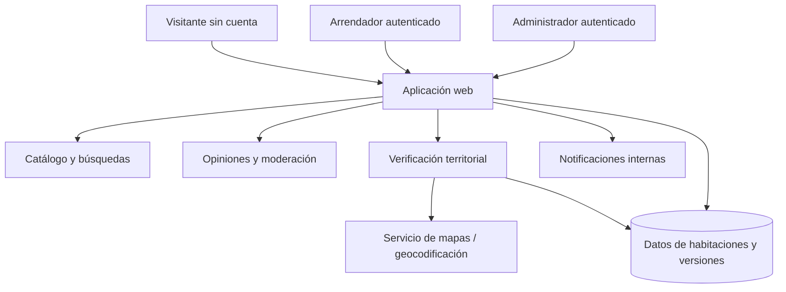
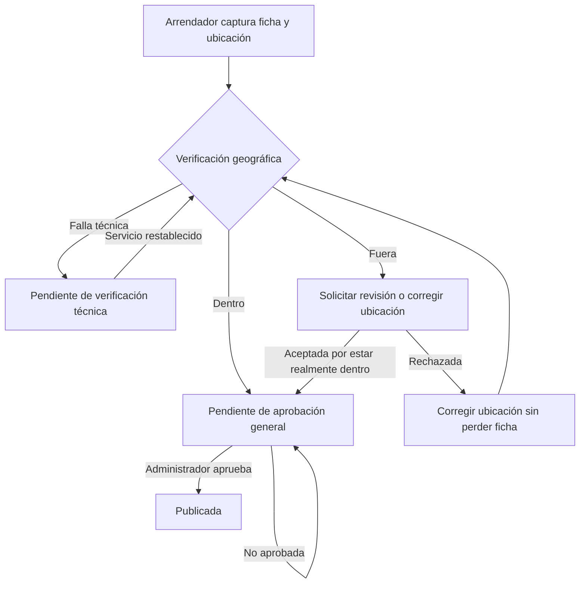
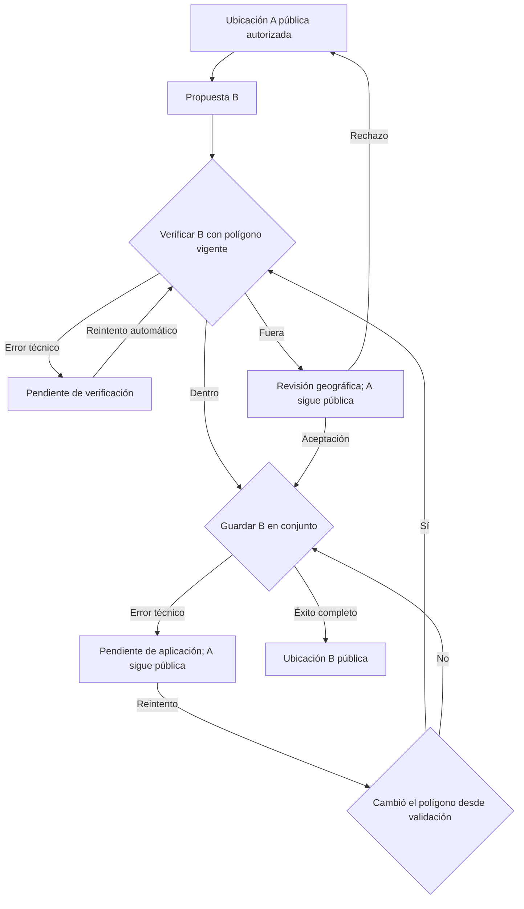

# Especificación de Requisitos de Software (SRS)

**Producto:** Plataforma web de habitaciones en renta en la localidad de Ixtlán, Oaxaca  
**Identificador:** SRS-IXT-001  
**Versión:** 1.0  
**Fecha de emisión:** 23 de octubre de 2026  
**Estado:** pendiente de revisión y aprobación formal del conjunto documental  
**Marco de organización:** plantilla **Software Requirements Specification — SRS Template, Master SIGLIS / Industry 4.0, v1.1**, basada en IEEE 830; complementada con criterios de trazabilidad y verificación usados en ISO/IEC/IEEE 29148:2018.

**Autor:** Uriel Aguilar Mauricio

> **Control de procedencia.** Este documento consolida el proceso previo de elicitación: 158 decisiones confirmadas (D-01 a D-158), 50 identificadores de necesidades (N-01 a N-50), 11 stakeholders y numeración histórica de reglas hasta RN-967. Las **redacciones aquí consolidadas** son editoriales y no pretenden reproducir palabra por palabra todas las actas ni las 967 reglas. Se conservan como referencias exactas las decisiones finales disponibles; cualquier correspondencia global sin acta literal se identifica como trazabilidad temática. Los requisitos nuevos `RF-###` y `RNF-###` son identificadores propios de esta versión del catálogo y no equivalen a los antiguos `RN-###`. Las prestaciones todavía no decididas se etiquetan **PENDIENTE** y no deben tratarse como aprobadas.

## Ficha de aprobación y revisiones

| Función | Responsable | Estado |
|---|---|---|
| Autor de esta consolidación | Equipo de especificación (sin nombre asignado) | Borrador |
| Responsable del proyecto | Por designar | Pendiente |
| Propietario / aprobador del producto | Por designar | Pendiente |
| Revisor de requisitos y pruebas | Por designar | Pendiente |

| Versión | Fecha | Descripción |
|---|---|---|
| 1.0 | 2026-10-23 | Primera consolidación Markdown del alcance, stakeholders, necesidades y requisitos hasta D-158. |

## Resumen

Este documento define los requisitos de una plataforma web de consulta, comparación y publicación administrada de habitaciones en renta ubicadas **exclusivamente en la localidad de Ixtlán, Oaxaca**. Los visitantes pueden buscar, explorar, comentar y valorar sin cuenta; los arrendadores deben disponer de cuentas creadas por el administrador, y las nuevas publicaciones requieren aprobación. El sistema aplica reglas estrictas de pertenencia territorial, gestiona versiones del polígono local y preserva datos ante fallas de geoverificación o guardado, con notificaciones y reintentos automáticos.

**Palabras clave:** SRS; ingeniería de requisitos; habitaciones en renta; Ixtlán; delimitación geográfica; moderación; trazabilidad; integridad.

## Tabla de contenido

1. [Introducción](#1-introducción)
2. [Descripción general](#2-descripción-general)
3. [Requisitos específicos](#3-requisitos-específicos)
4. [Anexos de trazabilidad, estados y pruebas](#4-anexos-de-trazabilidad-estados-y-pruebas)

---

# 1. Introducción

## 1.1 Propósito

Definir comportamientos, interfaces, límites, atributos y condiciones verificables del producto antes de su diseño e implementación. Es una especificación para el promotor, arrendadores, administrador, analista, desarrolladores, equipo de pruebas, soporte y revisores. Cada requisito debe poder rastrearse a una necesidad y a un caso de aceptación.

## 1.2 Alcance

El producto es un **sitio web de anuncios de habitaciones** con búsquedas cartográficas y gestión administrativa. Su territorio cubre **solamente la localidad de Ixtlán, Oaxaca**; no basta estar dentro de límites municipales.

Incluye listado y búsqueda pública, fichas de habitaciones, contacto directo, cuentas de arrendadores creadas por administración, altas sujetas a aprobación, edición y eliminación, comentarios y estrellas moderados, mecanismos de control de abuso y apelación, cartografía territorial versionada, revisiones y excepciones individuales justificadas, auditoría administrativa y recuperación automática tras fallos técnicos.

No se han aprobado módulos de reserva transaccional, pagos, facturación, contratos de arrendamiento ni extensión a otras localidades. **Ausencia de definición** no equivale a prohibición perpetua: su incorporación requeriría control formal de cambios.

## 1.3 Organización del documento

La sección 2 presenta actores, funciones generales, restricciones, supuestos y dependencias. La sección 3 contiene interfaces, funcionalidades y atributos de calidad. Los anexos incorporan diccionario, estados, escenarios, trazabilidad y asuntos pendientes. Los archivos complementarios proporcionan la lista detallada de expectativas, necesidades y criterios individuales de cada requisito.

## 1.4 Definiciones, acrónimos y abreviaturas

| Término | Definición |
| --- | --- |
| SRS | Especificación de Requisitos de Software. |
| Stakeholder | Parte interesada en el producto o en su resultado. |
| ST | Identificador de parte interesada. |
| N | Identificador de necesidad de stakeholder. |
| RF | Identificador de requisito funcional consolidado. |
| RNF | Identificador de requisito no funcional consolidado. |
| RN | Identificador histórico de regla de negocio del proceso de elicitación. |
| D | Identificador histórico de decisión confirmada. |
| Localidad de Ixtlán | Área habitada delimitada cartográficamente considerada en el alcance; no equivale al municipio entero. |
| Polígono vigente | Versión activa de la geometría territorial usada para determinar pertenencia. |
| Marcador | Coordenadas de localización de una habitación en el mapa. |
| Geocodificación | Proceso de proponer coordenadas a partir de dirección escrita. |
| Verificación geográfica | Comprobación de pertenencia de coordenadas al polígono vigente. |
| Excepción geográfica | Autorización administrativa de una habitación realmente dentro de la localidad, pese a clasificación automática exterior errónea. |
| Aprobación general | Decisión del administrador para publicar una habitación nueva, diferente de validación geográfica. |
| Pendiente de verificación | Estado técnico en que todavía no se obtuvo clasificación territorial fiable. |
| Pendiente de aplicación | Estado técnico en que ya existe validación favorable, pero no se logró guardar la nueva ubicación. |
| Renta base | Precio mensual de habitación sin sumar cargos adicionales por servicios. |
| MXN | Peso mexicano. |
| RPO / RTO | Objetivos de pérdida de datos / tiempo de recuperación; pendientes de definición. |

## 1.5 Referencias documentales

1. **SRS_Template.doc.docx**, plantilla adjunta por el solicitante; secciones *Introduction*, *General Description*, *Requirements* y anexos de trazabilidad.
2. **IEEE Std 830**, referido como base de la plantilla; esta especificación adapta su organización sin afirmar conformidad formal certificada.
3. **ISO/IEC/IEEE 29148:2018**, marco de ingeniería de requisitos trabajado durante la elicitación; la redacción procura unicidad, trazabilidad y posibilidad de verificación.
4. Documentos hermanos de la presente entrega Markdown: [descripción](./descripcion%20del%20proyecto.md), [stakeholders](./stakeholders.md), [deseos y necesidades](./lista%20de%20deseos%20y%20necesidades.md) y [catálogo de requisitos](./lista%20de%20requisitos.md).

# 2. Descripción general

## 2.1 Perspectiva del producto

Se trata de una aplicación web de consulta pública y gestión autenticada con dependencias cartográficas y de persistencia. La vista pública solo debe acceder a publicaciones visibles y datos autorizados. La gestión por arrendador se limita a las habitaciones de su propiedad; el administrador dispone de controles de aprobación, moderación, corrección y gestión de límites. El proveedor técnico de mapas y alojamiento no está seleccionado.

El diagrama es conceptual, no una imposición de arquitectura física o proveedor.

## 2.2 Funciones principales del producto

| Función | Resultado observable | Requisitos principales |
| --- | --- | --- |
| Descubrimiento público | Listado y fichas con contacto, fotos, estado y mapa | RF-001–RF-017 |
| Búsqueda y orden | Filtros compuestos por precio, zona, distancia y características | RF-018–RF-042 |
| Gestión de habitaciones | Cuentas administradas, altas, aprobación, edición y eliminación | RF-043–RF-072 |
| Opiniones y apelaciones | Comentarios/estrellas moderados y seguimiento por folio | RF-073–RF-090 |
| Ubicación y revisiones | Geocodificación, geoverificación, excepciones y correcciones | RF-091–RF-113 |
| Polígono territorial | Versiones, evaluación de impacto y comunicación | RF-114–RF-141 |
| Recuperación geográfica | Estados técnicos, reintentos, bloqueos, coherencia y avisos | RF-142–RF-169 |

## 2.3 Características de los usuarios

| Tipo | Experiencia esperada | Implicación |
| --- | --- | --- |
| Visitante / inquilino | Puede desconocer detalles técnicos y no necesita cuenta. | Lenguaje claro y navegación accesible; mapa y filtros comprensibles. |
| Arrendador | Opera formularios web; no se presupone conocimiento GIS. | Marcadores confirmables, validaciones, avisos de pendientes. |
| Administrador | Gestiona colas, moderación y delimita polígonos. | Interfaces de historial, vista previa y decisiones justificadas. |
| Soporte | Investiga errores e integraciones. | Distinguir fallos de verificación frente a aplicación. |

## 2.4 Restricciones generales

- El ámbito geográfico es la **localidad**, nunca todo el municipio por defecto.
- Los visitantes no deben ser obligados a crear cuenta para explorar ni para aportar opiniones/estrellas.
- Solo administración registra arrendadores; publicación inicial requiere aprobación general.
- No puede aplicarse una nueva ubicación que no supere la validación requerida.
- Se debe usar el polígono vigente con contención **inclusiva de frontera**, sin buffer automático.
- Las decisiones de excepción no autorizan habitaciones realmente fuera de la localidad.
- Los historiales de polígonos y eliminaciones definidos se conservan según reglas aprobadas y límites legales.
- El rendimiento, recuperación medible, protección de datos y accesibilidad están **pendientes de cuantificación**.

## 2.5 Supuestos y dependencias

| Dependencia / supuesto | Implicación | Estado |
| --- | --- | --- |
| Datos cartográficos de la localidad | Requiere fuente oficial adecuada o trazado administrativo cerrado. | Fuente concreta sin seleccionar |
| Servicio de geocodificación | Puede fallar; permite confirmación/corrección manual del marcador. | Proveedor por definir |
| Componente cartográfico | Muestra polígono y marcadores a visitantes y administración. | Proveedor por definir |
| Almacenamiento | Debe preservar estado de publicaciones, propuestas y versiones sin escrituras parciales. | Tecnología por definir |
| Cuenta de administrador | Necesaria para aprobar arrendadores, habitaciones y revisiones. | Mecanismo exacto de provisión pendiente |
| Servicio de notificaciones internas | Debe funcionar para arrendador y administrador según eventos aprobados. | Canal interno confirmado; implementación pendiente |
| Regulación de privacidad | Afecta contactos públicos, IP/señales antiabuso e historiales. | Análisis legal pendiente |

# 3. Requisitos específicos

## 3.1 Requisitos de interfaces externas

### 3.1.1 Interfaces de usuario

| Interfaz | Entradas previstas | Salidas/validaciones | Usuarios |
|---|---|---|---|
| Catálogo público | Criterios de búsqueda y orden | Fichas visibles, precio base y disponibilidad | Visitantes y demás roles |
| Detalle de habitación | Selección de publicación | Fotos, dirección, zona, pin, servicios y contactos; comentarios aprobados | Visitantes |
| Filtros | Rango MXN, zonas, centro/radio km, estado, servicios, amueblado, baño y capacidad | Validación de rango; AND entre familias y OR dentro de zonas/servicios | Visitantes |
| Mapa | Selección de centro y alternancia mostrar/ocultar polígono | Polígono visible por defecto y marcador autorizado | Todos |
| Formulario de habitación | Campos obligatorios y 1–5 imágenes, confirmación de pin | Mensajes de datos inválidos, estado de revisión | Arrendador |
| Administración | Aprobaciones, motivos y decisiones territoriales | Colas, publicaciones, avisos, historial e impacto previo | Administrador |
| Opiniones | Comentario, alias opcional, calificación 1–5 | Estado pendiente de moderación o bloqueo/apelación | Visitantes |
| Apelaciones | Motivo y consulta mediante folio | Folio único; Pendiente/Aceptada/Rechazada | Visitantes |
| Notificaciones | Apertura de mensajes | Estado técnico, resolución y habitación afectada | Arrendador, administrador |

**Validación:** los formatos visuales finales no se prescriben aquí; sin embargo, todos los controles deben mostrar entradas, resultados y errores descritos, sin ocultar estados que alteran la interpretación del usuario.

### 3.1.2 Interfaces de hardware

No se exige hardware especializado. Se espera funcionamiento desde dispositivos capaces de utilizar un navegador compatible. La matriz concreta de dispositivos y navegadores está **pendiente** (RNF-010).

### 3.1.3 Interfaces de software

- **Geocodificador:** recibe dirección escrita y ofrece propuesta de coordenadas cuando está disponible; el usuario confirma o corrige el marcador.
- **Mapa/cartografía:** representa el polígono de localidad y los marcadores. Debe distinguir versiones y permitir revisión de impacto administrativo.
- **Persistencia:** conserva fichas, fotografías/referencias, opiniones, estados, apelaciones, notificaciones, historial de eliminaciones y versiones territoriales.
- **Servicio de reintentos:** procesa propuestas geográficas pendientes al restablecerse dependencias, sin sobrescribir datos ajenos ni reactivar habitaciones eliminadas.

No se ha aprobado un proveedor, SDK, API o formato de intercambio concreto. Su definición debe elaborarse en el diseño de interfaces sin inventar aquí versiones de terceros.

### 3.1.4 Interfaces de comunicación

- Acceso web desde navegador mediante conexión de red.
- Contacto externo por teléfono o enlace de WhatsApp registrado en la ficha. Esto **no implica** un chat interno del producto.
- Notificaciones **dentro de la aplicación**, sin requisito aprobado de SMS, correo electrónico ni push externo.

## 3.2 Requisitos funcionales por característica

Los siguientes requisitos están numerados de manera única. El [catálogo de requisitos](./lista%20de%20requisitos.md) incluye para cada ID un criterio concreto de aceptación. Los valores de prioridad son propuestos, no acuerdos de implementación.

### 3.2.1. Consulta pública

**Propósito:** permitir la exploración transparente de publicaciones aprobadas.

| ID | Requisito | Necesidad | Origen |
| --- | --- | --- | --- |
| RF-001 | El sistema deberá permitir consultar habitaciones publicadas sin iniciar sesión ni crear una cuenta. | N-01,N-02 | Acuerdos de consulta pública |
| RF-002 | El sistema deberá mostrar habitaciones publicadas tanto disponibles como rentadas. | N-01,N-09 | Acuerdos de listado y disponibilidad |
| RF-003 | El sistema deberá ordenar inicialmente el listado por fecha de aprobación administrativa más reciente. | N-01,N-07 | Acuerdos de listado y disponibilidad |
| RF-004 | El sistema deberá identificar cada habitación pública como «Disponible» o «Rentada». | N-05,N-15 | Acuerdos de listado y disponibilidad |
| RF-005 | El sistema deberá mostrar el precio base mensual en pesos mexicanos para cada publicación. | N-03 | Decisiones de precio |
| RF-006 | El sistema deberá diferenciar la renta mensual base de costos adicionales por servicios. | N-03,N-05 | Decisiones de servicios |
| RF-007 | El sistema deberá mostrar la dirección exacta escrita autorizada de cada habitación publicada. | N-04 | D-147 |
| RF-008 | El sistema deberá mostrar la colonia, barrio o zona autorizada de cada habitación. | N-04 | D-147 |
| RF-009 | El sistema deberá mostrar el marcador cartográfico correspondiente a la ubicación autorizada. | N-04 | D-147 |
| RF-010 | El sistema deberá mostrar las fotografías registradas de cada habitación pública. | N-06 | Decisiones de fotografías |
| RF-011 | El sistema deberá mostrar servicios, amueblado, baño y capacidad máxima de cada habitación. | N-05 | Decisiones de campos |
| RF-012 | El sistema deberá mostrar teléfono y/o enlace de WhatsApp registrados para contactar al arrendador según la información de contacto disponible. | N-16,N-36 | Decisiones de contacto |
| RF-013 | El sistema deberá mostrar el promedio de las calificaciones aprobadas de una habitación. | N-08,N-09 | Decisiones de valoración |
| RF-014 | El sistema deberá mostrar «Sin calificaciones» cuando no existan calificaciones aprobadas. | N-08 | Decisiones de valoración |
| RF-015 | El sistema deberá mostrar el polígono territorial vigente de Ixtlán por defecto al abrir un mapa público. | N-04,N-47 | D-129–D-131 |
| RF-016 | El sistema deberá permitir ocultar y volver a mostrar el polígono vigente sin cambiar su uso para validación. | N-04,N-47 | D-130 |
| RF-017 | El sistema deberá restablecer el polígono a visible cada vez que se abra un mapa, sin persistir la elección anterior. | N-04,N-47 | D-131 |

### 3.2.2. Búsquedas

**Propósito:** seleccionar y ordenar habitaciones con semántica de filtros verificable.

| ID | Requisito | Necesidad | Origen |
| --- | --- | --- | --- |
| RF-018 | El sistema deberá admitir un precio mensual base mínimo e incluir habitaciones cuyo precio sea igual al límite. | N-07 | Decisiones de filtros |
| RF-019 | El sistema deberá admitir un precio mensual base máximo e incluir habitaciones cuyo precio sea igual al límite. | N-07 | Decisiones de filtros |
| RF-020 | El sistema deberá señalar error si el precio mínimo es mayor que el máximo, conservando los demás filtros introducidos. | N-07 | Decisiones de filtros |
| RF-021 | El sistema deberá admitir límites mínimo y máximo iguales como búsqueda por precio exacto. | N-07 | Decisiones de filtros |
| RF-022 | El sistema deberá permitir seleccionar múltiples valores de colonia, barrio o zona. | N-07 | Decisiones de filtros |
| RF-023 | El sistema deberá devolver habitaciones de cualquiera de las zonas seleccionadas. | N-07 | Decisiones de filtros |
| RF-024 | El sistema deberá obtener las zonas seleccionables desde habitaciones aprobadas, incluidas rentadas y disponibles. | N-07 | Decisiones de zonas |
| RF-025 | El sistema deberá comparar zonas ignorando diferencias de mayúsculas, tildes y espacios sobrantes. | N-07 | Decisiones de zonas |
| RF-026 | El sistema no deberá considerar automáticamente equivalentes «Centro» y «Zona Centro» por semejanza semántica. | N-07 | Decisiones de zonas |
| RF-027 | El sistema deberá permitir seleccionar un punto central en el mapa y un radio positivo expresado en kilómetros. | N-04,N-07 | Decisiones de distancia |
| RF-028 | El sistema deberá admitir radios reales positivos con decimales y sin máximo fijo predeterminado. | N-07 | Decisiones de distancia |
| RF-029 | El sistema deberá filtrar por distancia geodésica en línea recta entre centro elegido y marcador vigente de la habitación. | N-07 | Decisiones de distancia |
| RF-030 | El sistema deberá incluir habitaciones ubicadas exactamente en el límite de distancia elegido. | N-07 | Decisiones de distancia |
| RF-031 | El sistema deberá permitir filtrar habitaciones por «Disponible» o «Rentada». | N-07,N-15 | Decisiones de filtros |
| RF-032 | El sistema deberá ofrecer filtro basado únicamente en el catálogo de diez servicios normalizados. | N-05,N-07 | Decisiones de servicios |
| RF-033 | Cuando se seleccionen varios servicios, el sistema deberá incluir habitaciones que tengan por lo menos uno de los seleccionados. | N-07 | Decisiones de filtros |
| RF-034 | El sistema deberá permitir filtrar habitaciones sin servicios incluidos mediante una opción excluyente de otras selecciones de servicios. | N-07 | Decisiones de servicios |
| RF-035 | El sistema deberá permitir elegir exactamente un tipo de amueblado: amueblada, parcialmente amueblada o sin amueblar. | N-05,N-07 | Decisiones de filtros |
| RF-036 | El sistema deberá permitir elegir un tipo de baño: privado o compartido. | N-05,N-07 | Decisiones de filtros |
| RF-037 | El sistema deberá devolver habitaciones cuya capacidad máxima permitida sea mayor o igual al mínimo indicado. | N-05,N-07 | Decisiones de filtros |
| RF-038 | El sistema deberá combinar mediante AND las familias de filtros activas, manteniendo OR únicamente dentro de zonas y servicios seleccionados. | N-07 | Decisiones de filtros |
| RF-039 | El sistema deberá ordenar opcionalmente por renta base mensual de menor a mayor. | N-03,N-07 | Decisiones de orden |
| RF-040 | El sistema deberá ordenar opcionalmente por renta base mensual de mayor a menor. | N-03,N-07 | Decisiones de orden |
| RF-041 | El sistema deberá ordenar opcionalmente por promedio aprobado descendente y colocar al final las habitaciones sin calificaciones aprobadas. | N-08,N-07 | Decisiones de orden |
| RF-042 | El sistema deberá utilizar solo la renta base mensual para buscar y ordenar por precio, sin sumar cargos extra de servicios. | N-03,N-07 | Decisiones de precio |

### 3.2.3. Gestión de habitaciones

**Propósito:** administrar cuentas y el ciclo de vida de anuncios.

| ID | Requisito | Necesidad | Origen |
| --- | --- | --- | --- |
| RF-043 | El sistema deberá permitir que únicamente el administrador registre cuentas de arrendadores. | N-10,N-19 | D-06; acuerdos de cuentas |
| RF-044 | El sistema deberá requerir autenticación para crear y administrar publicaciones del arrendador. | N-11 | D-06; acuerdos de cuentas |
| RF-045 | El sistema deberá permitir a un arrendador editar o eliminar exclusivamente sus propias habitaciones. | N-11 | Decisiones de permisos |
| RF-046 | El sistema deberá permitir a un arrendador autenticado presentar una nueva habitación con campos obligatorios válidos. | N-10,N-11 | Decisiones de registro |
| RF-047 | El sistema deberá mantener sin publicar cada habitación nueva hasta contar con aprobación administrativa y verificación geográfica favorable. | N-19,N-20,N-48 | D-89,D-100; acuerdos de aprobación |
| RF-048 | El sistema deberá aplicar los cambios permitidos de habitaciones aprobadas sin requerir una nueva aprobación general, respetando controles geográficos. | N-11,N-14 | D-06 |
| RF-049 | El sistema deberá exigir al menos una fotografía en las publicaciones. | N-06,N-12 | Decisiones de fotos |
| RF-050 | El sistema deberá admitir como máximo cinco fotografías por habitación. | N-06,N-12 | Decisiones de fotos |
| RF-051 | El sistema deberá seleccionar aleatoriamente una fotografía de portada al registrar el conjunto inicial de imágenes. | N-06,N-12 | Decisiones de portada |
| RF-052 | El sistema deberá conservar la portada mientras no cambie el conjunto de fotografías. | N-06 | Decisiones de portada |
| RF-053 | El sistema deberá volver a seleccionar aleatoriamente la portada cuando se agregue, retire o reemplace alguna fotografía. | N-06 | Decisiones de portada |
| RF-054 | El sistema deberá requerir una renta mensual base como entero positivo en MXN, sin centavos. | N-03,N-12 | Decisiones de precio |
| RF-055 | El sistema deberá exigir una dirección exacta escrita por habitación. | N-04,N-12 | Decisiones de dirección |
| RF-056 | El sistema deberá exigir barrio, colonia o zona en texto. | N-04,N-12 | Decisiones de dirección |
| RF-057 | El sistema deberá exigir coordenadas confirmadas mediante marcador cartográfico para tramitar una habitación. | N-04,N-41 | D-81–D-83 |
| RF-058 | El sistema deberá requerir estado Disponible o Rentada. | N-15,N-12 | Decisiones de campos |
| RF-059 | El sistema deberá permitir seleccionar los servicios incluidos y declarar explícitamente «Ninguno» cuando corresponda. | N-05,N-12 | Decisiones de servicios |
| RF-060 | El sistema deberá ofrecer los diez servicios normalizados: Agua, Electricidad, Internet/Wi-Fi, Gas, Acceso a cocina, Lavandería, Estacionamiento, Servicio de limpieza, Seguridad o vigilancia y Áreas comunes. | N-05 | Decisiones de servicios |
| RF-061 | El sistema deberá permitir indicar servicios adicionales de texto libre en el detalle, sin incorporarlos al filtro normalizado. | N-05 | Decisiones de servicios |
| RF-062 | El sistema deberá distinguir por servicio si está incluido en renta o implica cargo adicional. | N-05 | Decisiones de servicios |
| RF-063 | El sistema deberá permitir un importe conocido para el servicio de cargo adicional. | N-05 | Decisiones de servicios |
| RF-064 | El sistema deberá permitir marcar un cargo adicional como «Costo variable / Consultar al arrendador». | N-05 | Decisiones de servicios |
| RF-065 | El sistema deberá exigir una de las tres categorías de amueblado definidas. | N-05,N-12 | Decisiones de campos |
| RF-066 | El sistema deberá exigir baño privado o compartido. | N-05,N-12 | Decisiones de campos |
| RF-067 | El sistema deberá exigir capacidad máxima de ocupantes como entero positivo. | N-05,N-12 | Decisiones de campos |
| RF-068 | El sistema deberá permitir editar los campos no geográficos de habitaciones propias respetando sus validaciones. | N-11,N-14 | D-145,D-157 |
| RF-069 | El sistema deberá permitir al arrendador eliminar sus habitaciones con motivo opcional y conservar registro administrativo. | N-11,N-37,N-40 | Decisiones de eliminación,D-158 |
| RF-070 | El sistema deberá permitir al administrador eliminar publicaciones con motivo obligatorio y aviso dentro de la aplicación al arrendador. | N-19,N-22 | Decisiones de eliminación |
| RF-071 | El sistema deberá registrar actor, momento y motivo cuando corresponda en el historial de eliminaciones. | N-37,N-38,N-39 | Decisiones de auditoría |
| RF-072 | El sistema deberá permitir al arrendador consultar el historial correspondiente a sus propias habitaciones eliminadas. | N-40 | Decisiones de auditoría |

### 3.2.4. Opiniones

**Propósito:** recoger experiencias moderadas y tratar apelaciones de bloqueos.

| ID | Requisito | Necesidad | Origen |
| --- | --- | --- | --- |
| RF-073 | El sistema deberá permitir enviar comentarios sobre habitaciones sin crear cuenta. | N-08 | Decisiones de comentarios |
| RF-074 | El sistema deberá permitir enviar calificaciones sin crear cuenta. | N-08 | Decisiones de calificaciones |
| RF-075 | El sistema deberá aceptar comentario, calificación o ambos en una misma aportación. | N-08 | Decisiones de opiniones |
| RF-076 | El sistema deberá permitir alias opcional y usar «Anónimo» cuando no se proporcione. | N-08 | Decisiones de comentarios |
| RF-077 | El sistema deberá aceptar únicamente números enteros de 1 a 5 como calificación. | N-08 | Decisiones de calificaciones |
| RF-078 | El sistema deberá retener comentarios hasta aprobación del administrador. | N-08,N-20 | Decisiones de moderación |
| RF-079 | El sistema deberá retener calificaciones hasta aprobación administrativa independiente. | N-08,N-20 | Decisiones de moderación |
| RF-080 | El sistema deberá permitir aprobar un comentario sin aprobar su calificación asociada y viceversa. | N-08,N-20 | Decisiones de moderación |
| RF-081 | El sistema deberá calcular la media aritmética de las estrellas aprobadas exclusivamente. | N-08 | Decisiones de valoración |
| RF-082 | El sistema deberá ejecutar controles automáticos de posible abuso al intentar enviar una calificación, usando señales de IP, frecuencia y dispositivo/navegador conforme a política a definir. | N-08,N-09 | Decisiones de antispam |
| RF-083 | El sistema no deberá aplicar automáticamente el bloqueo de calificaciones a un comentario independiente, salvo regla específica aprobada. | N-08 | Decisiones de antispam |
| RF-084 | El sistema deberá permitir impugnar un bloqueo de calificación sin registro mediante formulario con motivo. | N-08 | Decisiones de apelación |
| RF-085 | El sistema deberá generar un folio único de consulta para cada apelación presentada. | N-08 | Decisiones de apelación |
| RF-086 | El sistema deberá permitir consultar por folio los estados Pendiente, Aceptada o Rechazada. | N-08 | Decisiones de apelación |
| RF-087 | El sistema deberá permitir al administrador aceptar o rechazar apelaciones. | N-20 | Decisiones de apelación |
| RF-088 | El sistema no deberá publicar automáticamente una calificación tras aceptar su apelación; deberá someterla a moderación administrativa habitual. | N-08,N-20 | Decisiones de apelación |
| RF-089 | El sistema deberá permitir al administrador eliminar definitivamente comentarios o calificaciones aprobadas con motivo obligatorio. | N-20,N-22 | Decisiones de eliminación |
| RF-090 | El sistema deberá conservar el registro administrativo de eliminación, con actor, fecha y motivo, sujeto a obligaciones legales. | N-23,N-38 | Decisiones de auditoría |

### 3.2.5. Geografía

**Propósito:** confirmar ubicación en la localidad y resolver excepciones reales.

| ID | Requisito | Necesidad | Origen |
| --- | --- | --- | --- |
| RF-091 | El sistema deberá intentar obtener coordenadas a partir de la dirección exacta escrita antes de que el arrendador confirme el marcador. | N-41 | D-81 |
| RF-092 | El sistema deberá exigir confirmación explícita del marcador sugerido o corregido por el arrendador. | N-41 | D-81 |
| RF-093 | El sistema deberá permitir colocar manualmente el marcador si falla la geocodificación automática. | N-41 | D-82 |
| RF-094 | El sistema deberá intentar geocodificar nuevamente y solicitar confirmación del marcador cuando el arrendador cambie la dirección escrita. | N-11,N-41 | D-83 |
| RF-095 | El sistema deberá permitir proponer un nuevo marcador sin cambiar la dirección escrita, sujeto a verificación territorial. | N-11 | D-84 |
| RF-096 | El sistema deberá permitir al administrador corregir el marcador de cualquier habitación, sujeto a las restricciones de estados geográficos. | N-19,N-21 | D-85,D-140,D-156 |
| RF-097 | El sistema deberá notificar al arrendador dentro de la aplicación cuando el administrador corrija un marcador. | N-13 | D-86 |
| RF-098 | El sistema no deberá exigir un historial de versiones para cada corrección individual del marcador de una habitación. | N-48 | D-87 |
| RF-099 | El sistema deberá evaluar pertenencia a la LOCALIDAD de Ixtlán, no al municipio completo. | N-24,N-42,N-48 | D-88 |
| RF-100 | El sistema deberá verificar pertenencia territorial automáticamente y requerir revisión administrativa antes de aprobar habitaciones nuevas. | N-19,N-42 | D-89 |
| RF-101 | El sistema deberá considerar dentro un punto situado exactamente sobre una arista o vértice del polígono vigente. | N-42,N-48 | D-132 |
| RF-102 | El sistema deberá considerar fuera todo punto realmente externo al polígono, por cercano que esté; no aplicará amortiguación automática. | N-42,N-48 | D-133 |
| RF-103 | El sistema deberá permitir solicitar revisión por clasificación externa mediante «Solicitar revisión», sin exigir datos adicionales. | N-43 | D-90,D-91 |
| RF-104 | El sistema deberá informar dentro de la aplicación al arrendador si su revisión geográfica es aceptada o rechazada. | N-13,N-43 | D-92 |
| RF-105 | El sistema deberá permitir al administrador aprobar una excepción geográfica individual únicamente si constata que la ubicación REALMENTE está dentro de la localidad, pese a error del polígono. | N-19,N-44 | D-93 |
| RF-106 | El sistema deberá invalidar una excepción geográfica anterior al proponerse/aplicarse coordenadas distintas y exigir nueva evaluación. | N-44,N-49 | D-94 |
| RF-107 | El sistema deberá mantener la ubicación antigua publicada sin aplicar nuevas coordenadas clasificadas fuera mientras su revisión esté pendiente. | N-11,N-49 | D-95 |
| RF-108 | El sistema deberá descartar coordenadas propuestas rechazadas y mantener visible la ubicación previamente autorizada. | N-11,N-49 | D-96 |
| RF-109 | El sistema deberá impedir tener simultáneamente dos revisiones geográficas pendientes para la misma habitación. | N-19,N-49 | D-97 |
| RF-110 | El sistema deberá impedir que el arrendador cambie las coordenadas propuestas durante una revisión administrativa geográfica pendiente. | N-49 | D-98 |
| RF-111 | El sistema deberá aplicar automáticamente coordenadas propuestas de habitación publicada cuando su revisión geográfica sea aceptada, sin aprobación general repetida. | N-11,N-49 | D-99 |
| RF-112 | El sistema deberá enviar una habitación nueva cuya revisión geográfica fue aceptada a la cola habitual de aprobación, sin publicarla de inmediato. | N-19,N-49 | D-100 |
| RF-113 | El sistema deberá conservar datos de habitación no publicada cuya revisión fue rechazada y permitir corregir ubicación. | N-11,N-49 | D-101 |

### 3.2.6. Delimitación territorial

**Propósito:** gestionar y versionar límites geográficos sin borrar antecedentes.

| ID | Requisito | Necesidad | Origen |
| --- | --- | --- | --- |
| RF-114 | El sistema deberá utilizar la delimitación oficial de la localidad cuando resulte aplicable y haya sido validada para su uso. | N-45,N-48 | D-102 |
| RF-115 | El sistema deberá permitir que el administrador trace un polígono cerrado cuando no haya delimitación oficial adecuada. | N-19,N-45 | D-103 |
| RF-116 | El sistema deberá mantener activa la delimitación manual hasta que el administrador revise y confirme su reemplazo por otra oficial. | N-45 | D-104 |
| RF-117 | El sistema deberá reevaluar todas las habitaciones publicadas y pendientes de aprobación tras confirmar nueva delimitación. | N-42,N-46 | D-105 |
| RF-118 | El sistema deberá mantener visibles habitaciones publicadas que queden fuera bajo nuevo polígono mientras el administrador determina su situación real. | N-46 | D-106 |
| RF-119 | El sistema deberá ocultar públicamente sin borrar habitaciones publicadas que el administrador confirme realmente fuera de la localidad. | N-19,N-46 | D-106 |
| RF-120 | El sistema deberá informar al arrendador cuando su habitación sea ocultada por confirmarse fuera del territorio. | N-13 | D-107 |
| RF-121 | El sistema deberá permitir al arrendador corregir el marcador de habitaciones ocultas por territorialidad y restaurar visibilidad cuando la ubicación resulte autorizada. | N-11,N-49 | D-108 |
| RF-122 | El sistema deberá notificar al arrendador cuando una habitación oculta recupere visibilidad. | N-13 | D-109 |
| RF-123 | El sistema deberá pausar la aprobación de habitaciones nuevas clasificadas fuera tras un cambio territorial. | N-19,N-46 | D-110 |
| RF-124 | El sistema deberá permitir corregir ubicaciones de habitaciones nuevas confirmadas realmente fuera, sin perder los demás datos de la ficha. | N-11 | D-111 |
| RF-125 | El sistema deberá notificar al arrendador de una habitación nueva confirmada fuera del área que debe corregir la ubicación. | N-13 | D-112 |
| RF-126 | El sistema deberá reevaluar las excepciones geográficas previamente autorizadas cuando cambie el polígono; una excepción antigua no debe autorizar automáticamente el punto frente al nuevo límite. | N-44,N-46 | D-113 |
| RF-127 | El sistema deberá permitir al administrador modificar un polígono manual u oficial y etiquetar su procedencia correctamente. | N-45 | D-114,D-119 |
| RF-128 | El sistema deberá registrar una versión nueva con polígono, fecha y administrador por cada cambio de delimitación confirmado. | N-50 | D-115 |
| RF-129 | El sistema deberá permitir restaurar una versión anterior generando una NUEVA versión activa sin eliminar la historia. | N-50 | D-116 |
| RF-130 | El sistema deberá clasificar origen de cada versión en Manual, Oficial, Oficial modificada o Restaurada. | N-50 | D-117 |
| RF-131 | El sistema deberá conservar en versiones oficiales organismo, conjunto de datos, versión/fecha y enlace fuente cuando exista. | N-50 | D-118 |
| RF-132 | El sistema deberá conservar metadatos de fuente oficial en versiones «Oficial modificada». | N-50 | D-119 |
| RF-133 | El sistema deberá almacenar en cada versión «Restaurada» el identificador de la versión restaurada y metadatos heredables. | N-50 | D-120 |
| RF-134 | El sistema deberá mantener el historial de versiones territoriales durante su vida operativa, salvo obligaciones legales aplicables. | N-38,N-50 | D-121 |
| RF-135 | El sistema deberá exigir motivo escrito para modificaciones y restauraciones del polígono y conservarlo inmutable en la nueva versión. | N-23,N-50 | D-122 |
| RF-136 | Antes de confirmar un cambio/restauración, el sistema deberá mostrar el total y listado de habitaciones que cambiarían dentro↔fuera. | N-46,N-50 | D-123 |
| RF-137 | La vista previa deberá identificar excepciones previas que requerirían revisión nueva o dejarían de ser necesarias. | N-44,N-46 | D-124 |
| RF-138 | El sistema deberá notificar al arrendador cuando cambio del polígono genere revisión administrativa geográfica, antes de resolverla. | N-13,N-46 | D-125,D-126 |
| RF-139 | El sistema deberá notificar el resultado favorable de la revisión sobrevenida; publicadas siguen visibles y nuevas reanudan aprobación. | N-13,N-46 | D-127 |
| RF-140 | El sistema deberá restringir la visualización del historial territorial completo al administrador. | N-19,N-50 | D-128 |
| RF-141 | El sistema deberá permitir a visitantes y arrendadores visualizar el polígono vigente, sin permisos de historial o edición. | N-47 | D-129 |

### 3.2.7. Recuperación geográfica

**Propósito:** recuperar fallas técnicas preservando datos, notificaciones y coherencia pública.

| ID | Requisito | Necesidad | Origen |
| --- | --- | --- | --- |
| RF-142 | El sistema deberá conservar la propuesta y marcar «Pendiente de verificación por problema técnico» cuando no pueda clasificar la ubicación por problema técnico. | N-32,N-48 | D-134 |
| RF-143 | El sistema no deberá publicar habitaciones nuevas mientras carezcan de verificación geográfica válida. | N-19,N-48 | D-134 |
| RF-144 | El sistema deberá reintentar automáticamente las verificaciones pendientes cuando se restablezca el servicio. | N-31,N-48 | D-135 |
| RF-145 | El sistema deberá avisar dentro de la aplicación al arrendador cuando la verificación pendiente termine Dentro o Fuera de Ixtlán. | N-13 | D-136 |
| RF-146 | Si falla verificación de coordenadas propuestas de habitación publicada, el sistema deberá conservar visibles los datos de ubicación antes autorizados. | N-04,N-11,N-48 | D-137 |
| RF-147 | Tras reintento favorable de coordenadas nuevas en habitación publicada, el sistema deberá aplicar automáticamente la propuesta validada y avisar al arrendador, sin otra aprobación. | N-11,N-13 | D-138 |
| RF-148 | El sistema deberá impedir al arrendador sustituir nuevas coordenadas mientras su verificación técnica esté pendiente. | N-11,N-49 | D-139 |
| RF-149 | El sistema deberá impedir al administrador sustituir las coordenadas propuestas mientras la misma verificación técnica esté pendiente. | N-19,N-49 | D-140 |
| RF-150 | El sistema deberá notificar al arrendador al entrar por primera vez al estado de verificación pendiente e informar reintento automático. | N-13 | D-141 |
| RF-151 | El sistema deberá notificar individualmente al administrador por cada habitación que entre a verificación técnica pendiente. | N-19 | D-142 |
| RF-152 | El sistema deberá notificar individualmente al administrador cuando cada verificación técnica pendiente termine, con clasificación Dentro/Fuera. | N-19 | D-143 |
| RF-153 | El sistema no deberá emitir nuevas notificaciones por reintentos fallidos mientras persista la misma verificación pendiente. | N-13,N-19 | D-144 |
| RF-154 | El sistema deberá permitir al arrendador cambiar precio, fotografías, servicios y disponibilidad durante verificación técnica pendiente. | N-11,N-14 | D-145 |
| RF-155 | El sistema deberá bloquear dirección escrita, colonia/barrio/zona y coordenadas propuestas para arrendador y administrador durante verificación técnica pendiente. | N-11,N-19 | D-146 |
| RF-156 | Mientras verificación técnica pendiente, el sistema deberá mostrar a visitantes dirección, zona y marcador anteriores juntos. | N-04,N-09 | D-147 |
| RF-157 | Al aplicar nueva ubicación el sistema deberá actualizar indivisiblemente dirección, zona y coordenadas sin mostrar combinaciones de versión vieja/nueva. | N-04,N-48 | D-148 |
| RF-158 | Si falla guardado de ubicación ya validada, el sistema deberá conservar ubicación antigua y propuesta validada en estado «Pendiente de aplicación por problema técnico». | N-11,N-32 | D-149 |
| RF-159 | El sistema deberá reintentar automáticamente el guardado de ubicación validada pendiente cuando se restablezca el servicio. | N-31,N-32 | D-149 |
| RF-160 | El sistema deberá volver a verificar propuesta validada pero aún no aplicada si cambió la versión del polígono desde validación. | N-48,N-50 | D-150 |
| RF-161 | El sistema no deberá aplicar automáticamente propuesta clasificada fuera tras reverificación con polígono vigente; deberá habilitar revisión. | N-44,N-48 | D-150 |
| RF-162 | Si falla técnicamente la reverificación requerida por cambio de polígono, la propuesta deberá pasar de pendiente de aplicación a pendiente de verificación. | N-31,N-48 | D-151 |
| RF-163 | El sistema deberá notificar al arrendador y administrador sobre ese cambio de estado debido a nuevo polígono y falla técnica. | N-13,N-19 | D-152 |
| RF-164 | El sistema deberá notificar al arrendador y administrador cuando guardado de ubicación ya validada quede pendiente, explicando reintento automático. | N-13,N-19 | D-153 |
| RF-165 | Cuando el guardado pendiente termine íntegramente, el sistema deberá notificar éxito al arrendador y administrador. | N-13,N-19 | D-154 |
| RF-166 | El sistema no deberá generar más notificaciones por reintentos de guardado fallidos mientras continúe el mismo estado pendiente de aplicación. | N-13,N-19 | D-155 |
| RF-167 | El sistema deberá impedir al arrendador y administrador modificar dirección, zona y coordenadas de propuesta validada en estado pendiente de aplicación. | N-11,N-19 | D-156 |
| RF-168 | El sistema deberá permitir al arrendador editar datos no geográficos durante aplicación pendiente sin sobrescribirlos al completar guardado geográfico. | N-11,N-14 | D-157 |
| RF-169 | El sistema deberá permitir al arrendador eliminar una habitación con aplicación pendiente, cancelar el cambio y detener los reintentos para impedir reaparición. | N-11,N-32 | D-158 |

## 3.3 Requisitos de rendimiento

**Estado de definición:** pendiente de cuantificación. No se atribuyen umbrales inventados al solicitante.

- `RNF-007`: tiempo de búsqueda — establecer carga de prueba, percentil y tiempo máximo.
- `RNF-008`: disponibilidad de servicio — establecer porcentaje y ventana de cálculo.
- `RNF-014`: tiempo de renderizado del mapa y polígono — establecer cantidad de marcadores y condiciones de red.
- Definir límites de concurrencia, volumen de habitaciones/fotografías y tasas de publicación y opiniones.

**Formato de aceptación pendiente (plantilla):** «Bajo [número] usuarios concurrentes y [volumen] habitaciones, al menos [porcentaje] de las búsquedas finalizará en no más de [segundos]». Los valores entre corchetes no son requisitos acordados.

## 3.4 Restricciones de diseño

### 3.4.1 Cumplimiento de normas y reglas

La documentación debe conservar identificadores únicos, términos consistentes, criterios de aceptación y trazabilidad; la organización de este SRS sigue la plantilla proporcionada basada en IEEE 830 y considera prácticas de ISO/IEC/IEEE 29148:2018. Ello no constituye una afirmación de auditoría o conformidad formal.

Las obligaciones legales específicas para datos de contacto publicados, huellas de navegador/IP, historial administrativo y retención **se evaluarán antes de despliegue**. No se fija aquí una interpretación jurídica sin validarla.

### 3.4.2 Restricciones de hardware

Sin equipo especializado confirmado. Navegadores y tamaños de pantalla compatibles: por definir.

## 3.5 Atributos de calidad del producto

| ID | Atributo | Requisito o compromiso | Estado |
| --- | --- | --- | --- |
| RNF-001 | Seguridad de acceso por roles | El sistema deberá restringir la administración de publicaciones y del polígono territorial a roles autenticados autorizados. | Confirmado funcionalmente; falta política de sesiones |
| RNF-002 | Aislamiento entre arrendadores | El sistema deberá impedir acceso de un arrendador a gestión, notificaciones e historiales exclusivos de otro. | Confirmado |
| RNF-003 | Integridad geográfica | El sistema deberá aplicar en una única operación consistente el conjunto dirección-zona-coordenadas. | Confirmado |
| RNF-004 | Conservación del historial territorial | El sistema deberá conservar versiones históricas del polígono por toda la vida operativa, sujeto a obligaciones legales aplicables. | Confirmado |
| RNF-005 | Recuperación automática de verificación | El sistema deberá reintentar automáticamente verificaciones pendientes tras restablecimiento del servicio y conservar las propuestas. | Confirmado; cadencia sin definir |
| RNF-006 | Recuperación automática de aplicación | El sistema deberá reintentar operaciones de aplicación geográfica fallidas sin perder datos ni modificar públicamente parcialmente la ubicación. | Confirmado; cadencia sin definir |
| RNF-007 | Tiempo de respuesta de búsquedas | El sistema deberá satisfacer un tiempo de respuesta bajo carga definida. | PENDIENTE: cuantificar percentil, segundos, concurrencia |
| RNF-008 | Disponibilidad global | El sistema deberá satisfacer el nivel de disponibilidad acordado por el propietario del proyecto. | PENDIENTE: porcentaje, ventana y mantenimiento |
| RNF-009 | Accesibilidad de interfaz | El sistema deberá alcanzar un nivel de accesibilidad verificable para sus interfaces web. | PENDIENTE: norma/nivel/alcance |
| RNF-010 | Compatibilidad | El sistema deberá funcionar en navegadores y tamaños de pantalla identificados como compatibles. | PENDIENTE: matriz de dispositivos y versiones |
| RNF-011 | Respaldo y recuperación | El sistema deberá soportar respaldo y restauración de datos conforme a objetivos de pérdida y recuperación acordados. | PENDIENTE: frecuencia, RPO y RTO |
| RNF-012 | Privacidad y tratamiento de datos | El sistema deberá manejar teléfono público, señales antiabuso y datos de auditoría conforme al marco legal aplicable. | PENDIENTE: aviso, base legal, retención y consentimiento |
| RNF-013 | Protección de comunicaciones | El sistema deberá proteger comunicaciones y credenciales durante autenticación y administración. | PENDIENTE: controles técnicos concretos |
| RNF-014 | Rendimiento cartográfico | El sistema deberá representar mapa, marcadores y polígono dentro de objetivos de rendimiento mensurables. | PENDIENTE: tamaños/carga/tiempos |
| RNF-015 | Operabilidad y diagnóstico | El sistema deberá permitir a soporte distinguir fallos de verificación de fallos de aplicación sin alterar reglas de visibilidad. | Confirmado conceptualmente; PENDIENTE instrumentación |

### 3.5.1 Disponibilidad y recuperación

Se ha confirmado recuperación automática de las dos clases de incidencia geográfica, sin pérdida de propuesta y sin publicar datos mezclados. Aún falta definir cuantitativamente el nivel global de disponibilidad, tiempos de recuperación, número máximo o cadencia de reintentos, RPO y RTO.

### 3.5.2 Seguridad

Cuentas autenticadas para arrendadores y administrador; autorización por propietario; historial territorial solo del administrador; avisos privados para destinatarios pertinentes. Las medidas concretas de autenticación reforzada, cifrado, gestión de sesiones y controles antiabuso deben diseñarse con la política de privacidad aplicable.

### 3.5.3 Mantenibilidad

Los estados técnicos de verificación/aplicación y las transiciones territoriales deben distinguirse para soporte. Arquitectura modular, observabilidad, cobertura de pruebas y niveles de complejidad no están aún cuantificados.

### 3.5.4 Transferibilidad / conversión

No se ha especificado una migración a otra plataforma, tecnología ni proveedor. Si se define en etapas posteriores, deberá añadirse requisito con entorno, formato, pruebas y criterio de aceptación.

## 3.6 Otros requisitos

### 3.6.1 Operación y administración

La solución deberá ejecutar las funciones contempladas en `RF-042` y posteriores según privilegios, preservar las autorizaciones administrativas y avisar de estados geográficos clave sin duplicaciones por reintentos. Las tareas de respaldo, eliminación legal y monitoreo operacional se detallarán al definir RNF pendientes.

### 3.6.2 Adaptación a la localidad

El sistema no debe confundir el polígono de la localidad con el del municipio. El administrador puede usar geometría oficial apropiada o trazado manual cerrado; todas las modificaciones/restauraciones requieren motivo, versión nueva y análisis de impacto previo. El polígono vigente es visible al público, y su historial solo al administrador.

---

# 4. Anexos de trazabilidad, estados y pruebas

## 4.1 Modelo lógico de entidades (no impone tecnología)

| Entidad conceptual | Información mínima relevante |
| --- | --- |
| Arrendador | Identificador, acceso autenticado, relación de propiedad con habitaciones. |
| Habitación | Identificador, dueño, precio MXN, fotos, servicios, ocupación, baño, amueblado, disponibilidad, contacto y estado de publicación. |
| Ubicación autorizada | Dirección escrita, colonia/zona, coordenadas y versión aplicable de evaluación. |
| Propuesta geográfica | Conjunto geográfico propuesto, estado de verificación/aplicación y datos necesarios para reintento. |
| Publicación / aprobación | Fecha de aprobación inicial, decisión administrativa, visibilidad pública y motivo de ocultación cuando corresponda. |
| Comentario | Texto, alias, moderación y habitación asociada. |
| Calificación | Estrellas enteras 1–5, moderación independiente y controles de posible abuso. |
| Apelación | Folio único, motivo, estado y decisión del administrador. |
| Notificación | Destinatario, habitación, evento y contenido comunicable. |
| Versión de polígono | Geometría, tipo de origen, fecha, actor, motivo, metadatos oficiales y versión de procedencia cuando sea restaurada. |
| Historial de eliminación | Contenido administrativo mínimo, actor, fecha y motivo obligatorio u opcional según quien elimina. |

## 4.2 Estados y transiciones esenciales

### 4.2.1 Ciclo de una habitación nueva

La clasificación *Dentro* no sustituye la aprobación administrativa general.

### 4.2.2 Actualización de ubicación de habitación publicada

**Restricción de integridad:** mientras B no esté aplicada completamente, las consultas públicas deben seguir utilizando A en dirección, colonia/zona, marcador y filtros cartográficos. Las ediciones no geográficas guardadas entretanto no deben perderse cuando se aplique B.

### 4.2.3 Polígono geográfico

Polígono propuesto → vista previa de impacto → motivo obligatorio → confirmación administrativa → nueva versión vigente → reevaluación de habitaciones y excepciones → revisión de las potencialmente exteriores → ocultación o conservación según determinación real. Una restauración añade nueva versión «Restaurada» con referencia a la versión histórica; no borra su antecesora.

## 4.3 Reglas computables y límites

**Precio.** `precio_base_mensual ∈ Z` y `precio_base_mensual > 0`, unidad MXN. Filtros `min ≤ precio ≤ max`; `min > max` implica error sin borrar otros criterios; `min = max` es permitido.

**Capacidad.** `capacidad_maxima ∈ Z`, `capacidad_maxima > 0`, coincide cuando `capacidad_maxima ≥ minimo_solicitado`.

**Fotos.** Número de fotografías registradas de la habitación de 1 a 5 inclusive.

**Rating.** `estrellas ∈ {1,2,3,4,5}`. Promedio = suma de las estrellas aprobadas / número de estrellas aprobadas. Si no existe calificación aprobada, mostrar «Sin calificaciones» y ubicar al final del ordenamiento por promedio.

**Distancia.** Distancia geodésica en kilómetros entre el punto central seleccionado y las coordenadas **publicadas** de la habitación; se incluye cuando `distancia ≤ radio`, `radio > 0`, sin techo fijo.

**Filtros.** Conjunción lógica entre familias; disyunción entre valores seleccionados de zonas y de servicios normalizados. La selección «Sin servicios incluidos» es excluyente de otros servicios.

**Territorialidad.** `Dentro = polígono_vigente cubre punto`, incluyendo lados y vértices del polígono. No existe distancia de tolerancia exterior automática. La excepción administrativa solo es legítima si el punto corresponde realmente a la localidad.

## 4.4 Escenarios de aceptación de extremo a extremo

| Caso | Objetivo | Precondición | Estímulo | Resultado verificable | Trazabilidad |
| --- | --- | --- | --- | --- | --- |
| CA-01 | Búsqueda anónima con filtros | Visitante sin cuenta; habitaciones visibles aprobadas | Aplica rango precio, 2 zonas, 2 servicios y disponibilidad | Resultados cumplen el rango y disponibilidad; AND entre familias y OR dentro de zonas y servicios. | RF-001, RF-018–RF-042 |
| CA-02 | Precio inválido | Hay otros filtros ya introducidos | Introduce precio mínimo 3000 y máximo 2000 | Error visible y otros filtros se conservan. | RF-020 |
| CA-03 | Radio inclusivo | Marcadores a distancia exactamente igual y ligeramente mayor al radio | Busca con radio positivo decimal | Incluye el punto sobre el límite; excluye el exterior. | RF-027–RF-030 |
| CA-04 | Colonia normalizada | Existen «Centro» y « cénTro » y «Zona Centro» | Abre selector | Las dos primeras se comparan como una zona; «Zona Centro» no se fusiona automáticamente. | RF-025, RF-026 |
| CA-05 | Publicación nueva | Arrendador autenticado registrado por administración | Envía ficha completa con pin dentro del polígono | La habitación permanece invisible hasta aprobación general. | RF-046, RF-047 |
| CA-06 | Servicios y precios | Publicación con renta 2000, Internet extra 500 | Busca por precio 2000 y mira detalle | Aparece por renta base; el cargo extra está separado. | RF-005, RF-006, RF-042 |
| CA-07 | Fotografías y portada | Ficha con tres fotos | Edita precio y después reemplaza una imagen | Edición de precio mantiene portada; cambio de conjunto regenera selección. | RF-049–RF-053 |
| CA-08 | Opinión sin cuenta | Visitante no autenticado | Envía comentario y 5 estrellas | Se tramitan estados de moderación independientes; promedio no cambia antes de aprobarse el voto. | RF-073–RF-081 |
| CA-09 | Apelación de bloqueo | Intento de calificación detectado como abuso | Envía motivo y consulta folio | Obtiene folio único y estado; aceptación no publica estrella automáticamente. | RF-082–RF-088 |
| CA-10 | Frontera del polígono | Punto exactamente en vértice o borde | Solicita verificación | Resultado Dentro. | Geografía / D-132 |
| CA-11 | Punto cercano exterior | Punto fuera a distancia arbitrariamente pequeña | Solicita verificación | Resultado Fuera; sin margen automático. | Geografía / D-133 |
| CA-12 | Excepción territorial | Automático marca fuera por límite erróneo pero administración constata localidad real | Arrendador solicita revisión con botón | Admin acepta excepción; si nueva publicación, todavía exige aprobación general. | D-90–D-101 |
| CA-13 | Cambio de polígono | Polígono V3 vigente; publicado está fuera de V4 | Administrador previsualiza y confirma V4 con motivo | Se genera V4; habitación publicada continúa visible hasta revisión de ubicación real. | D-105,D-106,D-123 |
| CA-14 | Historial/restauración | Existen versiones V1–V4 | Administrador restaura V2 y proporciona motivo | Se crea versión nueva de origen Restaurada con referencia V2, sin borrar anteriores. | D-115–D-122 |
| CA-15 | Error al verificar nueva ubicación publicada | Habitación visible con ubicación A, propuesta B | Se interrumpe geoverificación | Visitante ve A íntegra; B permanece bloqueada; sistema genera avisos de incidencia y reintenta. | D-134–D-147 |
| CA-16 | Reintento de verificación favorable | Caso CA-15 en pendiente | Servicio vuelve y B clasifica Dentro | Se aplica B conjunta, sin nueva confirmación; arrendador y administrador reciben avisos de resultado correspondientes. | D-136,D-138,D-143,D-148 |
| CA-17 | Fallos repetidos de verificación | Caso CA-15 en pendiente | Vuelve a fallar tres veces | Una notificación inicial por destinatario, no tres avisos nuevos. | D-141,D-142,D-144 |
| CA-18 | Falla de guardado después de validar | Propuesta B validada; A pública | Falla persistencia de actualización | A permanece pública, B pasa a pendiente de aplicación, se avisa a ambos; no hay combinación mixta. | D-148,D-149,D-153 |
| CA-19 | Recuperación de guardado | Caso CA-18 en pendiente y polígono sin cambios | Se recupera servicio y guardado se realiza íntegro | Se publica B completa, preserva cambios de precio; avisos de éxito a arrendador y administrador. | D-149,D-154,D-157 |
| CA-20 | Cambio de polígono entre validar/aplicar | Caso CA-18 en pendiente y se confirma nuevo polígono | Reintenta aplicación | Reverifica B con versión nueva; si fuera, no aplica y abre revisión. | D-150 |
| CA-21 | Error técnico en reverificación | Caso CA-20 requiere reevaluar B | La reverificación falla por servicio | Estado cambia a pendiente de verificación; conserva B; avisa cambio de estado a ambos. | D-151,D-152 |
| CA-22 | Fallos repetidos de aplicación | Caso CA-18 en pendiente | Falla tres veces el guardado | Se conserva A y B y no se generan alertas duplicadas del mismo estado. | D-155 |
| CA-23 | Bloqueo geográfico en pendiente de aplicación | Caso CA-18 en pendiente | Admin y arrendador intentan cambiar B | Se bloquean dirección, zona y pin de B para ambos. | D-156 |
| CA-24 | Ediciones ajenas a geografía | Caso CA-18 en pendiente | Arrendador modifica fotos y precio | Se permiten los cambios y no se pierden al aplicar B. | D-157 |
| CA-25 | Eliminar publicación con aplicación pendiente | Caso CA-18 en pendiente | Arrendador elimina habitación | Deja de publicarse; se cancelan reintentos; un trabajo pendiente no debe recrearla. | D-158 |
| CA-26 | Detección de duplicidad en filtros de servicios | Servicios Agua, Wi-Fi, y la selección especial Sin servicios | Selecciona Sin servicios y Agua simultáneamente | El sistema impide la combinación incompatible. | Búsquedas / decisiones de servicios |
| CA-27 | Consulta de versiones por roles | Visitante y administrador acceden a mapa | Intentan abrir versiones históricas | Visitante solo polígono vigente; administrador puede ver historial. | D-128–D-131 |
| CA-28 | Regla de opinión eliminada | Existe comentario/estrella aprobada | Administrador la elimina con motivo | Deja de figurar públicamente y de contarse en promedio, conservando auditoría. | Opiniones / decisiones de eliminación |

## 4.5 Matriz resumida de trazabilidad

La siguiente matriz enlaza bloques de necesidades y de requisitos; el archivo [`lista de deseos y necesidades.md`](./lista%20de%20deseos%20y%20necesidades.md) incluye la vinculación individual N → RF.

| Interesados | Necesidades | Áreas de requisitos | Casos de aceptación |
| --- | --- | --- | --- |
| ST-01 | N-01–N-09 | Consulta y búsquedas | CA-01–CA-04 |
| ST-02 | N-10–N-18 | Gestión de habitaciones, recuperación geográfica | CA-05–CA-07, CA-15–CA-25 |
| ST-03 | N-08,N-18 | Opiniones | CA-08–CA-09, CA-28 |
| ST-04 | N-19–N-23,N-42–N-50 | Opiniones, geografía, delimitación y recuperación | CA-10–CA-25, CA-27 |
| ST-05 | N-24,N-48 | Geografía, delimitación y recuperación | CA-10–CA-25 |
| ST-06–ST-09 | N-25–N-32 | RF trazables, RNF y escenarios de error | Todos los casos |
| ST-10–ST-11 | N-33–N-34 | Interfaces externas, RNF-012 | Pruebas específicas pendientes |

## 4.6 Matriz de cobertura de requisitos no funcionales

| RNF | Método de verificación propuesto | Criterio de cierre |
|---|---|---|
| RNF-001–RNF-002 | Pruebas de autorización entre cuentas/roles | No hay acceso no autorizado a gestión/avisos/historiales. |
| RNF-003 | Prueba de actualización concurrente y fallo de escritura | Solo se observa ubicación completa anterior o nueva. |
| RNF-004 | Revisión de versiones tras modificar/restaurar | No se pierden versiones históricas. |
| RNF-005–RNF-006 | Simulación de caída y restablecimiento de dependencias | Se retoma la tarea pendiente sin intervención ni pérdida de propuesta. |
| RNF-007–RNF-008 | Pruebas de carga y cálculo de disponibilidad | **Sin umbral acordado todavía.** |
| RNF-009–RNF-010 | Auditorías y pruebas multientorno | **Matriz/nivel pendientes.** |
| RNF-011 | Restauración controlada de respaldo | **RPO, RTO y periodicidad pendientes.** |
| RNF-012–RNF-013 | Revisión de política legal y seguridad | **Controles concretos pendientes.** |
| RNF-014 | Prueba de renderizado de mapa bajo carga | **Umbral pendiente.** |
| RNF-015 | Ensayos de fallos de mapa/persistencia | Incidencia clasificada según verificación/aplicación. |

## 4.7 Resumen de decisiones especialmente críticas

| Decisión | Norma operacional |
|---|---|
| D-06 | Una edición permitida de habitación publicada no exige nueva aprobación general. |
| D-87 | No se exige historial por movimiento individual de marcador. |
| D-88–D-89 | Localidad de Ixtlán y doble control de alta nueva. |
| D-93–D-101 | Excepciones únicamente para posiciones reales dentro de la localidad; una revisión no concede aprobación general automáticamente. |
| D-105–D-127 | Gestión de cambio territorial y de excepciones, con vista previa e historia. |
| D-128–D-133 | Historial administrativo, polígono actual público, bordes inclusivos, sin tolerancia exterior. |
| D-134–D-144 | Fallas/reintentos técnicos de verificación y avisos sin duplicación del mismo caso. |
| D-145–D-148 | Edición no geográfica permitida y conjunto de ubicación público coherente. |
| D-149–D-155 | Falla de aplicación, reverificación por nueva versión de polígono y comunicaciones de estados. |
| D-156–D-158 | Bloqueo de nueva ubicación pendiente, edición no geográfica y eliminación con cancelación de reintentos. |

## 4.8 Cuestiones abiertas y decisiones aún necesarias

1. **PD-001:** eliminar una habitación mientras su ubicación se halla «Pendiente de verificación por problema técnico». El acuerdo D-158 solo cubre «Pendiente de aplicación».
2. **PD-002:** tiempos de respuesta, volumen de habitaciones, usuarios simultáneos y disponibilidad mensurable.
3. **PD-003:** selección del proveedor cartográfico, datos oficiales y contratos/dependencias.
4. **PD-004:** aviso y base legal para teléfono visible, datos antiabuso (IP y señales de dispositivo), conservación, tratamiento de imágenes e historiales.
5. **PD-005:** accesibilidad web y matriz de navegadores/tamaños de pantalla.
6. **PD-006:** políticas de respaldo y recuperación, cadencia y límites de reintentos.
7. **PD-007:** cotejo de trazabilidad exhaustiva con actas originales D-01 a D-158 y RN-001 a RN-967. Sin esas actas, el vínculo a decisiones tempranas se marca por **tema**, no como certeza de un identificador no recuperado.

## 4.9 Condiciones para aprobar esta línea base

- Revisar con ST-02, ST-04 y ST-05 que el alcance y la distinción localidad/municipio sean correctos.
- Aprobar explícitamente redacciones consolidadas N-01 a N-50 y prioridades sugeridas.
- Revisar coherencia entre condiciones de publicación, revisión y cambios cartográficos.
- Completar RNF pendientes con metas verificables y responsables.
- Resolver PD-001 para cerrar totalmente el comportamiento de eliminación durante ambos tipos de incidencia técnica.
- Confirmar matriz de trazabilidad con las actas históricas disponibles.
- Obtener la firma/aprobación del propietario del producto y del responsable de requisitos.

**Nota final de alcance:** este documento especifica el comportamiento esperado; no certifica que exista una implementación ni que los objetivos técnicos no definidos se hayan satisfecho.

## 4.10 Correspondencia verificable con los intervalos recientes de reglas de negocio

Esta tabla registra los intervalos de reglas asociados a las decisiones D-136 a D-158 identificadas en la conversación. Para RN anteriores no se atribuye un texto literal inexistente en el material disponible.

| Decisión | Intervalo de RN históricas | Resumen de reglas |
|---|---|---|
| D-136 | RN-753–RN-761 | Notificación al arrendador de verificación finalizada |
| D-137 | RN-762–RN-771 | Conservación de ubicación antigua ante falla de verificación |
| D-138 | RN-772–RN-780 | Aplicación automática tras validación favorable |
| D-139 | RN-781–RN-788 | Bloqueo de propuesta para arrendador durante verificación pendiente |
| D-140 | RN-789–RN-796 | Bloqueo de propuesta también para administrador |
| D-141 | RN-797–RN-804 | Notificación inicial de falla de verificación al arrendador |
| D-142 | RN-805–RN-812 | Notificación inicial individual al administrador |
| D-143 | RN-813–RN-821 | Notificación del resultado final al administrador |
| D-144 | RN-822–RN-829 | Sin avisos repetidos de reintentos fallidos de verificación |
| D-145 | RN-830–RN-838 | Edición no geográfica durante verificación pendiente |
| D-146 | RN-839–RN-847 | Bloqueo de dirección, colonia y pin en verificación pendiente |
| D-147 | RN-848–RN-857 | Datos geográficos públicos anteriores mientras nueva ubicación pendiente |
| D-148 | RN-858–RN-867 | Aplicación íntegra y conjunta de datos geográficos |
| D-149 | RN-868–RN-877 | Conservación de ubicación y reintentos de guardado |
| D-150 | RN-878–RN-887 | Reverificación al cambiar el polígono vigente |
| D-151 | RN-888–RN-898 | Falla de reverificación: vuelta a pendiente de verificación |
| D-152 | RN-899–RN-907 | Notificar transición entre estados técnicos |
| D-153 | RN-908–RN-917 | Notificación inicial de falla de aplicación geográfica |
| D-154 | RN-918–RN-926 | Notificación tras recuperación de guardado |
| D-155 | RN-927–RN-936 | Sin avisos repetidos de reintentos fallidos de aplicación |
| D-156 | RN-937–RN-946 | Bloqueo de datos propuestos durante aplicación pendiente |
| D-157 | RN-947–RN-958 | Edición de datos no geográficos en aplicación pendiente |
| D-158 | RN-959–RN-967 | Eliminación con aplicación pendiente cancela reintentos |
